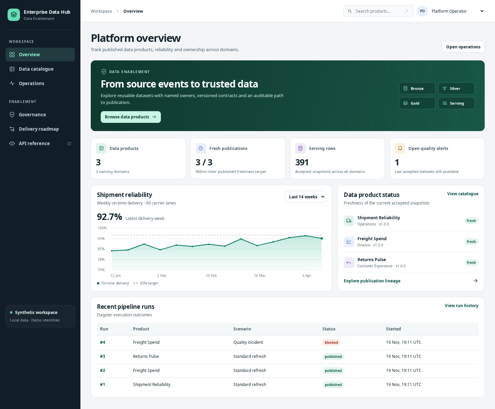
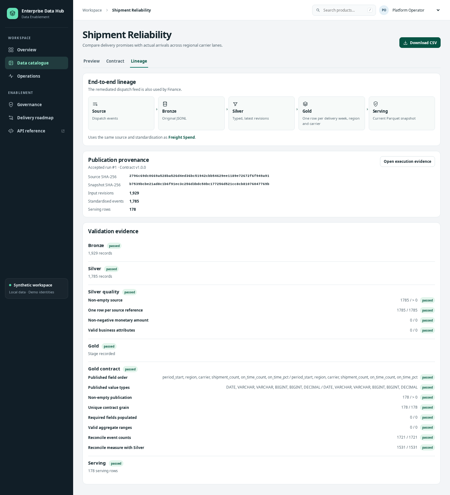
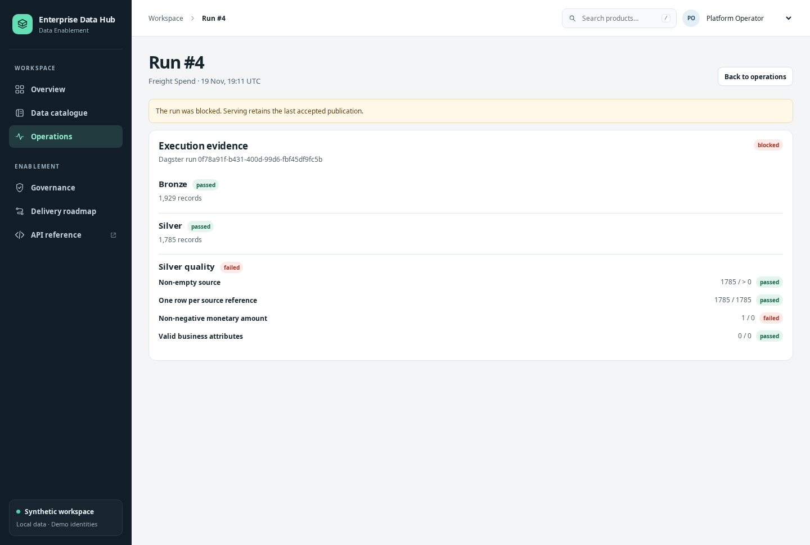
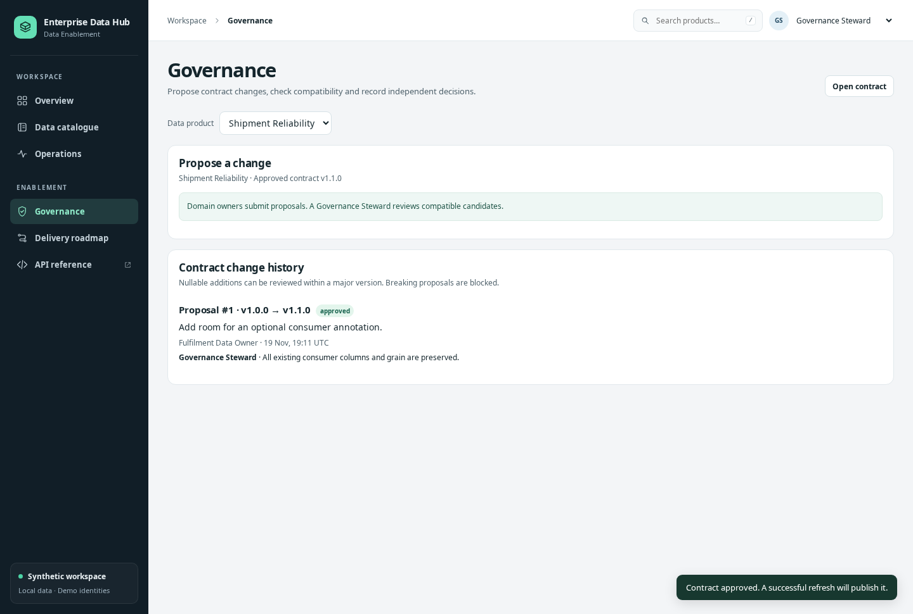
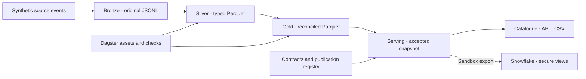

# Enterprise Data Hub

**A governed internal data platform for Operations, Finance and Customer Experience.**

Teams can adopt the same reliable data product when its grain, owner, quality gates and delivery promises are visible. Enterprise Data Hub demonstrates how a Data Enablement Product Owner turns that agreement into three consumable products and manages change without disrupting consumers. All events, organisational decisions and adoption targets are synthetic.



## Data products

| Product | Owner and first consumers | Business decision | Delivered contract |
| --- | --- | --- | --- |
| **Shipment Reliability** | Fulfilment · Business Improvement, Product Management | Decide where to start a carrier performance review. | Delivery week × region × carrier. Count delivered shipments and apply one on-time definition. |
| **Freight Spend** | Finance · Finance Planning, Operations | Explain monthly movements in booked freight costs. | Dispatch month × region × carrier. Report integer EUR cents and cost per shipment. |
| **Returns Pulse** | Customer Experience · Marketing, Product Management | Identify return reasons that warrant investigation. | Request week × channel × reason. Report request volume and refund exposure. |

| Capability | What to try |
| --- | --- |
| Catalogue and analytical use | Find a product by domain, inspect its grain and SLA, filter the preview and download the same slice as CSV. |
| Contract governance | Submit a nullable field as a Domain Owner, switch to the Governance Steward, approve it and publish it in a healthy refresh. Try removing a published measure to see the compatibility check block the proposal. |
| Dagster and quality | Replay a feed or inject a negative amount. Inspect blocking checks, the alert and the unchanged Serving publication, then run a healthy refresh to resolve the incident. |
| Lineage and reuse | Compare the Dispatch input digest and Silver counts for Operations and Finance. Trace an accepted aggregate back to its input and its Dagster run. |
| Product Ownership | Show where consumers disagreed, why a last-good SLA was prioritised, and what evidence must exist before Snowflake or a new region is admitted. |

<div align="center">
  
  
  
</div>

## Architecture



| Surface | Implementation |
| --- | --- |
| Local data plane | Python for input and provenance, DuckDB SQL over JSONL and Parquet, SQLite for transactional publication and governance metadata. |
| Execution and observability | Dagster assets and blocking checks, persistent run evidence, quality alerts and a publication-freshness watch. Optional daily schedules run on Dagster OSS. |
| Consumer experience | FastAPI and OpenAPI, HTML/CSS/JavaScript workspace, CSV and contract JSON. Browser assets are served locally. |
| Snowflake sandbox | Accepted Parquet, a provenance manifest, typed COPY, a reconciliation gate, a transactional pointer and product-scoped secure views. Local export and shared SQL syntax are exercised in tests. Applying the Snowflake scripts requires a sandbox account and separate acceptance. |

## Run from a clean checkout

With Python 3.11+:

```bash
python -m venv .venv
source .venv/bin/activate
python -m pip install -e ".[dev]"
python -m hub seed --with-incident
python -m uvicorn hub.api:app --host 127.0.0.1 --port 8000
```

On Windows PowerShell, activate with `.venv\Scripts\Activate.ps1`. Open [the workspace](http://127.0.0.1:8000) and [the OpenAPI reference](http://127.0.0.1:8000/docs). The optional seeded incident is an actual rejected synthetic load, so the job logs show an intentional Dagster failure before the CLI confirms `blocked`. Omit `--with-incident` for a clean operational view.

For Compose:

```bash
docker compose up --build
```

For the optional Dagster UI and daemon:

```bash
python -m pip install -e ".[orchestration]"
mkdir -p .state/dagster
export DAGSTER_HOME="$PWD/.state/dagster"
python -m dagster dev -m hub.orchestration -h 127.0.0.1 -p 3000
```

Set the same absolute `DAGSTER_HOME` and `HUB_STATE` (or use the same checkout and default `.state`) for the API and Dagster processes. Open [Dagster](http://127.0.0.1:3000), inspect the asset graph and enable individual schedules from the UI. Schedules are opt-in. Existing API runs from an ephemeral Dagster instance retain their evidence in the hub’s own journal.

```bash
python -m pytest -q
python -m playwright install chromium
python scripts/browser_smoke.py
```

The Python checks cover full lineage and reconciliation, unchanged Serving after a quality failure, alert recovery, versioned contracts, competing executions, exports and Snowflake SQL parsing. CI also launches the UI test and checks a fresh Compose startup.

## Product and engineering decisions

| Question | Evidence |
| --- | --- |
| Who decides scope, business definitions and release acceptance? | [Product strategy and operating model](docs/product.md) |
| What is delivered and what unlocks the next phase? | [Roadmap and live backlog conventions](docs/delivery.md) · [Backlog baseline](hub/contracts/delivery.json) · [Roadmap screen](assets/04-roadmap.png) |
| Why immutable layers, a pointer and two quality gates? | [Architecture and decision records](docs/architecture.md) |
| How do we accept or reject the next release in a review? | [Hands-on walkthrough](docs/walkthrough.md) |
| What is the Snowflake migration and security acceptance plan? | [Snowflake sandbox plan](docs/snowflake.md) |

This is a standalone portfolio demo. Simulated roles make responsibilities visible in the demo. Run it on localhost with synthetic inputs. The production identity, metering, backup and external-object-store decisions are tracked on the roadmap.

**License:** MIT.
